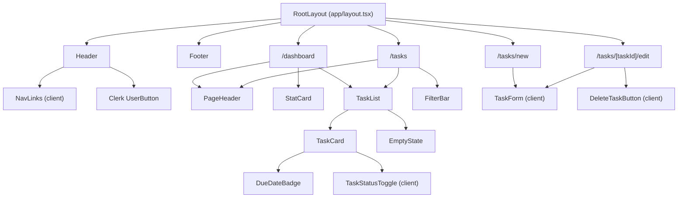
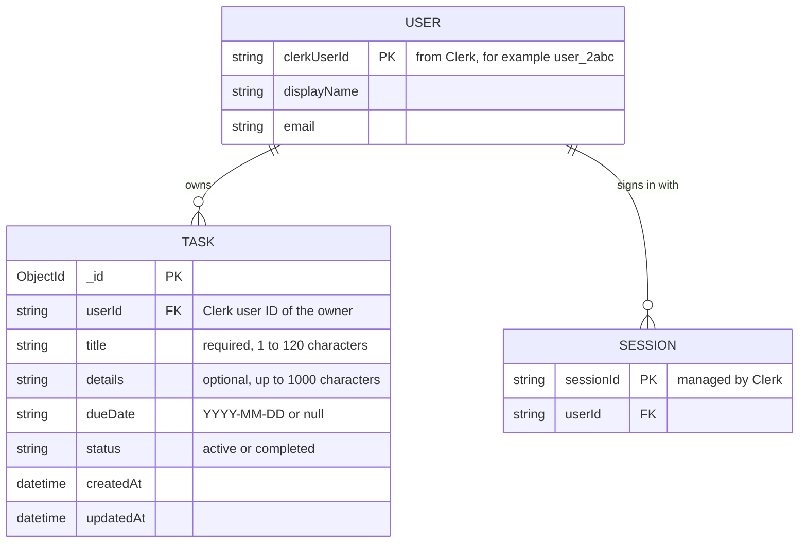

# TaskTrack Architecture

This document records the architecture decisions for TaskTrack: the MVP routes, the component hierarchy, the data model, and the order the work depends on. It is based on [`spec.md`](../spec.md) and kept in sync with [`.github/copilot-instructions.md`](../.github/copilot-instructions.md).

## Stack

| Layer          | Choice                                        | Why                                                                                                                                  |
| -------------- | --------------------------------------------- | ------------------------------------------------------------------------------------------------------------------------------------ |
| Framework      | Next.js App Router, TypeScript in strict mode | Server Components for data-heavy pages, Route Handlers for the API, one codebase                                                     |
| Styling        | Tailwind CSS                                  | Utility classes keep the design tokens in [`design-system.md`](design-system.md) consistent                                          |
| Database       | MongoDB                                       | Each task is a self-contained document with no joins, and optional fields (such as categories, #10) can be added without a migration |
| Authentication | Clerk                                         | Handles sign-up, sign-in, sign-out, sessions, and account settings, so the team can focus on task features                           |
| Hosting        | Vercel                                        | Native Next.js support and preview deployments for every pull request                                                                |

## MVP Routes

Route groups keep public authentication pages separate from signed-in pages without changing the URLs.

| Route                  | Group    | Purpose                                                        | Priority     |
| ---------------------- | -------- | -------------------------------------------------------------- | ------------ |
| `/`                    | none     | Landing page                                                   | P3           |
| `/sign-in`, `/sign-up` | `(auth)` | Clerk sign-in and sign-up                                      | P1           |
| `/dashboard`           | `(app)`  | Counts, upcoming tasks ordered by due date, recently completed | P3 (Week 04) |
| `/tasks`               | `(app)`  | Task list with an all / active / completed filter (`?status=`) | P2 (Week 04) |
| `/tasks/new`           | `(app)`  | Create a task                                                  | P2 (Week 04) |
| `/tasks/[taskId]/edit` | `(app)`  | Edit or delete a task                                          | P2 (Week 04) |
| `/profile`             | `(app)`  | Account details and settings                                   | P1           |

| API route             | Methods                                      |
| --------------------- | -------------------------------------------- |
| `/api/tasks`          | `GET ?status=all\|active\|completed`, `POST` |
| `/api/tasks/[taskId]` | `GET`, `PATCH`, `DELETE`                     |
| `/api/users/me`       | `GET`, `PATCH`                               |
| `/api/auth/session`   | `GET`                                        |

Every API route derives the user from the Clerk session, never from the request body, and scopes every query to that user.

## Component Hierarchy

Shared components live in `components/`, one per file. Pages are Server Components by default. Only the components that need browser interaction (`NavLinks`, `TaskForm`, `TaskStatusToggle`, `DeleteTaskButton`) are Client Components, and those call the API routes rather than the database.

The highest-priority components for Week 04 were `TaskCard`, `TaskList`, `FilterBar`, and `EmptyState`, because both the dashboard and the tasks page depend on them.

## Data Model

Three core entities. Clerk owns users and sessions. MongoDB stores tasks.

### User

Managed by Clerk. TaskTrack reads `clerkUserId`, `displayName`, and `email` from the session and does not store passwords or profile data itself.

### Task

Stored in the MongoDB `tasks` collection.

| Field       | Type                        | Rules                                                            |
| ----------- | --------------------------- | ---------------------------------------------------------------- |
| `_id`       | ObjectId                    | Primary key                                                      |
| `userId`    | string                      | Required. The Clerk user ID of the owner, taken from the session |
| `title`     | string                      | Required, trimmed, 1 to 120 characters                           |
| `details`   | string                      | Optional, up to 1000 characters, defaults to empty               |
| `dueDate`   | string or null              | Calendar date in `YYYY-MM-DD` format                             |
| `status`    | `"active"` or `"completed"` | Defaults to `"active"`                                           |
| `createdAt` | Date                        | Set on create                                                    |
| `updatedAt` | Date                        | Set on every change                                              |

Planned indexes:

- `{ userId: 1, status: 1 }` for the status filter on `/tasks`
- `{ userId: 1, dueDate: 1 }` for ordering upcoming tasks on the dashboard

### Session

Managed entirely by Clerk and not stored in MongoDB. Signed-out visitors to `(app)` pages are redirected to `/sign-in`, and API routes return `401`.

### Relationships

- **User to Task: one-to-many.** A user has many tasks, and each task belongs to exactly one user through `userId`.
- **User to Session: one-to-many.** A user can be signed in on several devices at once.
- There are no many-to-many relationships in the MVP.

## Dependencies and Build Order

1. Shared TypeScript types (`Task`, `TaskStatus`, `TaskInput`) are defined first, because the form, the API, and the pages all use them.
2. The data access layer exposes async functions scoped by `userId`, so the in-memory version used in Week 04 can be swapped for MongoDB (#2, #4) without changing pages or routes.
3. Clerk authentication (#1) replaces the temporary user ID before deployment.
4. Deployment (#19) waits on MongoDB and production Clerk keys.

## Coordination

Work is tracked on the [project board](https://github.com/users/T-FEH/projects/1) and grouped into weekly milestones. Every feature is built on its own branch and goes through a pull request that references the issue it closes. Progress, blockers, and carryover notes are recorded as issue comments.
